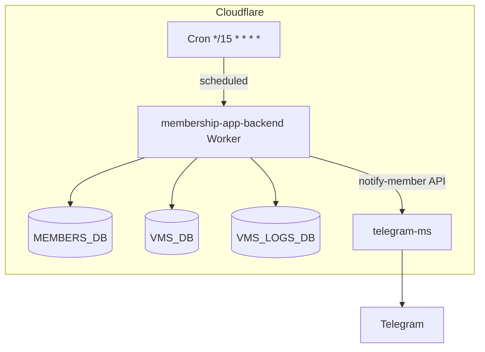

# Cron jobs plan (VMS + membership)

Scheduled work runs on the **membership-app-backend** Cloudflare Worker. That worker already has `MEMBERS_DB`, `VMS_DB`, and `TELEGRAM_MS_SERVICE`, and reuses `sendBackendTelegramNotification` for delivery.

**Operational state** (last remind/report times) stays on `VMS_DB`. **Append-heavy logs** (cron dedupe, audit trails, delivery history) go on a separate **`VMS_LOGS_DB`** so the main VMS database does not grow unbounded with notification rows.

## Goals

| Job | Audience | Channel | When |
|-----|----------|---------|------|
| Task reminders | Members with open work | Telegram DM | Adaptive (see below) |
| Owner daily report | `projects.owner` | Telegram DM | At most once per calendar day, only if yesterday had activity |
| Event reminders | Registered attendees | Telegram DM | 7d, 3d, 1d, 3h, 1h before `events.start_time` |

All three jobs run on the **same schedule**: every **15 minutes**.

---

## Architecture



### Worker entry

Today `backend/src/index.ts` only exports the Hono app. Implementation adds a **`scheduled`** handler alongside the HTTP app (same pattern as `old-app/src/backendMain.tsx`).

```ts
export default {
  fetch: app.fetch,
  async scheduled(event, env, ctx) {
    ctx.waitUntil(handleCron(env))
  },
}
```

### Wrangler trigger

```jsonc
// backend/wrangler.jsonc
// Cloudflare cron is UTC. 4–18 UTC = 07:00–21:59 Istanbul (+03:00). No runs 22:00–06:59 Istanbul.
"triggers": {
  "crons": ["*/15 4-18 * * *"]
}
```

Each run executes, in order:

1. `runTaskReminders`
2. `runOwnerDailyReports`
3. `runEventReminders`

No branching on `event.cron` — one expression, one handler.

**Timezone:** `CRON_TIMEZONE` defaults to `Europe/Istanbul` (+03:00). All calendar-day math (today, yesterday, due dates, owner report windows) uses Istanbul local time. Day boundaries are `00:00+03:00`–`00:00+03:00`, not UTC midnight. Message timestamps show local time with offset (e.g. `14:30 GMT+3`).

**Active hours (cron schedule):** Wrangler trigger `*/15 4-18 * * *` — every 15 minutes only when UTC hour is 4–18, which is **07:00–21:59 Istanbul**. No worker invocations during **22:00–06:59** Istanbul.

---

## Databases

| Binding | Database | Role |
|---------|----------|------|
| `VMS_DB` | `vms-database` | Core domain data + small cron **state** columns |
| `VMS_LOGS_DB` | `vms-logs-database` | Append-only **logs** (cron dedupe now; more later) |
| `MEMBERS_DB` | `membership-app-database` | Users, `telegram_id` for delivery |

Split rationale:

- VMS stays fast for app CRUD and joins.
- Logs can grow (every event reminder × attendee × offset) without bloating backups or migrations on core tables.
- Retention and purge policies apply only to the logs DB.
- Future tables (API audit, admin actions, failed notification retries) land here without touching `database/vms/`.

### Wrangler binding (backend)

```jsonc
// backend/wrangler.jsonc
{
  "d1_databases": [
    // ... MEMBERS_DB, VMS_DB ...
    {
      "binding": "VMS_LOGS_DB",
      "database_name": "vms-logs-database",
      "database_id": "<create in Cloudflare dashboard>",
      "remote": true,
      "migrations_dir": "../database/logs"
    }
  ]
}
```

Add `VMS_LOGS_DB: D1DatabaseLike` to `backend/src/types/bindings.ts`.

Other workers (e.g. telegram-ms) only need this binding if they write logs directly; for v1, **backend cron is the sole writer**.

---

## Schema changes (VMS DB)

Migration under `database/vms/` (e.g. `z0003_cron_columns.sql`). **No log tables here.**

### Column on `tasks`

```sql
ALTER TABLE tasks ADD COLUMN last_reminded_at TEXT;
-- ISO 8601; NULL until first reminder sent
```

Drives adaptive reminder spacing per task. Updated only after a successful Telegram send.

### Column on `projects`

```sql
ALTER TABLE projects ADD COLUMN last_reported_at TEXT;
-- ISO 8601; NULL until first daily report sent
```

Ensures at most **one owner report per calendar day** (in `CRON_TIMEZONE`): skip if `date(last_reported_at) = today`. Updated only after a successful send.

Tasks and projects do **not** need rows in the logs DB for dedupe—only the two columns above.

---

## Schema (VMS logs DB)

New directory: `database/logs/main.sql` (and numbered migrations as needed).

### `cron_notification_log` (events)

Dedupe per attendee per offset (`7d`, `3d`, `1d`, `3h`, `1h`).

```sql
CREATE TABLE IF NOT EXISTS cron_notification_log (
    id TEXT PRIMARY KEY,
    job_type TEXT NOT NULL DEFAULT 'event_reminder',
    entity_type TEXT NOT NULL DEFAULT 'event',
    entity_id TEXT NOT NULL,
    recipient TEXT NOT NULL,
    reminder_kind TEXT NOT NULL,
    sent_at TEXT NOT NULL DEFAULT (datetime('now')),
    metadata TEXT -- optional JSON: telegram message_id, error, etc.
);

CREATE UNIQUE INDEX IF NOT EXISTS idx_cron_log_dedupe
    ON cron_notification_log (job_type, entity_type, entity_id, recipient, reminder_kind);

CREATE INDEX IF NOT EXISTS idx_cron_log_sent_at ON cron_notification_log (sent_at);
```

`reminder_kind`: `7d` | `3d` | `1d` | `3h` | `1h`.

### Future log tables (not in v1)

Reserve the same DB for later, e.g.:

| Table | Use |
|-------|-----|
| `notification_delivery_log` | All Telegram sends (success/failure), not only cron |
| `admin_audit_log` | Privileged actions |
| `api_request_log` | Optional HTTP audit (if not using CF Logpush only) |

Keep new tables in `database/logs/` with the same append-only + retention mindset.

### Retention

Plan a periodic purge (separate cron or manual script) on `VMS_LOGS_DB`, e.g. delete `cron_notification_log` rows where `sent_at` older than 90 days and the event `start_time` has passed. Core VMS data is unaffected.

---

## Shared rules

### Eligible users

Join `user_info.telegram_id` (members DB). Skip recipients with no Telegram link; log failures in Worker logs.

### Telegram delivery

Reuse `backend/src/services/telegram-notification.service.ts` → `POST /api/notify-member` on telegram-ms.

Batch one DM per member per run when possible (task digest). Event reminders are one message per attendee per offset.

### Active projects only

VMS queries filter `projects.status = 'active'` unless noted.

### Status filters

| Entity | Include |
|--------|---------|
| Tasks | `status IN ('open', 'in_progress')`, `assigned_to IS NOT NULL` |
| Events | `status = 'public'`, `start_time IS NOT NULL`, `start_time > datetime('now')` |
| Registrations | `status = 'registered'` |

### Failure handling

Do **not** update `last_reminded_at`, `last_reported_at`, or `cron_notification_log` if Telegram delivery fails.

---

## 15-minute tick semantics

`now` = current instant. `window_start = now - 15 minutes`.

Used for event instant offsets. Calendar offsets (`7d`, `3d`, `1d`) use local dates in `CRON_TIMEZONE`.

---

## Job 1: Task reminders

**Purpose:** Remind assignees about open tasks across all active projects.

### Reminder interval

Let `remaining_days` = whole days from **start of today** (`CRON_TIMEZONE`) to **due date** (`tasks.due_date`, date part).

| Condition | Minimum days between reminders |
|-----------|--------------------------------|
| No `due_date` | 1 (daily) |
| `remaining_days < 0` (overdue) | 1 (daily) |
| `remaining_days < 8` | 1 (daily) |
| `remaining_days >= 8` | `max(1, floor(remaining_days / 4))` |

Examples:

| Due in | Interval |
|--------|----------|
| 8 days | 2 days |
| 12 days | 3 days |
| 20 days | 5 days |

### Eligibility

```sql
SELECT t.*, p.name AS project_name
FROM tasks t
JOIN projects p ON p.id = t.project_id
WHERE p.status = 'active'
  AND t.status IN ('open', 'in_progress')
  AND t.assigned_to IS NOT NULL;
```

Per task:

- `last_reminded_at IS NULL` → eligible.
- Else eligible if `days_between(last_reminded_at, now) >= interval_days` (compare in `CRON_TIMEZONE`).

### Grouping

Eligible tasks are grouped by `assigned_to`. One Telegram digest per member per run.

### Message content (Arabic, match existing notifications)

- Header: open task count
- Per task: name, project, due date, priority if high, link to project (`FRONTEND_BASE_URL/dashboard/projects/{id}`)
- Sort: overdue first, then due date, then priority

### After send

For every task included in the digest:

```sql
UPDATE tasks SET last_reminded_at = ? WHERE id = ?;
```

---

## Job 2: Owner daily report

**Purpose:** Send project owners a summary of **yesterday’s** activity. **Do not send** if nothing changed yesterday.

### Cadence (via `projects.last_reported_at`)

Skip project if `date(last_reported_at)` in `CRON_TIMEZONE` equals **today** — already sent today’s report.

Otherwise evaluate activity (below). If none → skip (do not update `last_reported_at`).

### Report date

`report_date` = yesterday’s `YYYY-MM-DD` in `CRON_TIMEZONE`.

### “Activity yesterday” definition

Any row with timestamp in `[report_date 00:00:00, report_date+1 00:00:00)` in `CRON_TIMEZONE`:

| Source | Timestamp column | Notes |
|--------|------------------|-------|
| `tasks` | `updated_at`, `created_at`, `completed_at` | `project_id` |
| `events` | `updated_at`, `created_at` | `project_id` |
| `event_registrations` | `updated_at`, `created_at` | Via `events.project_id` |
| `positions` | `updated_at`, `created_at` | `project_id` |
| `position_applications` | `updated_at`, `created_at` | Via `positions.project_id` |
| `points_transactions` | `created_at` | Via `tasks.project_id` when `task_id` set |
| `projects` | `updated_at` | Same `id` |
| `project_members` | — | No `created_at` today; add `joined_at` in a follow-up migration for “new member yesterday”, or omit until then |

If **no rows** match → skip.

### Report content

Telegram to `projects.owner`:

- Project name, `report_date`
- Sections (only if non-empty): tasks, events/registrations, positions/applications, points
- CTA: project dashboard link

### After send

```sql
UPDATE projects SET last_reported_at = ? WHERE id = ?;
```

With 15-minute ticks, the first successful run after midnight (once yesterday has activity) sends the report; later runs the same day are skipped via `last_reported_at`.

---

## Job 3: Event reminders

**Purpose:** Remind registered attendees at fixed offsets before `events.start_time`.

### Offsets and firing rules

| `reminder_kind` | Fire when (each 15-min run) |
|-----------------|----------------------------|
| `7d` | Local calendar date of `start_time` minus 7 days equals **today** in `CRON_TIMEZONE`, and not yet logged |
| `3d` | Local date minus 3 days equals today |
| `1d` | Local date minus 1 day equals today |
| `3h` | `start_time - 3h` ∈ `(window_start, now]` |
| `1h` | `start_time - 1h` ∈ `(window_start, now]` |

Calendar offsets (`7d`, `3d`, `1d`) fire on the matching **local day**; the first `*/15` run that day sends them (deduped via log).

Instant offsets (`3h`, `1h`) use the 15-minute window so each offset fires once without a separate hourly cron.

### Eligibility

```sql
SELECT e.*, er.membership_number
FROM events e
JOIN event_registrations er ON er.event_id = e.id
WHERE e.status = 'public'
  AND e.start_time IS NOT NULL
  AND datetime(e.start_time) > datetime('now')
  AND er.status = 'registered';
```

Skip if `VMS_LOGS_DB.cron_notification_log` already has `(event_reminder, event, event_id, membership_number, reminder_kind)`.

### Message content

- Event name, start time (local), location
- Links: event page, map from `associated_urls` if present

### After send

Insert into `VMS_LOGS_DB.cron_notification_log` per `(event, recipient, reminder_kind)`.

---

## Code layout (implementation checklist)

```
backend/src/
  cron/
    index.ts                 # handleCron(env) — runs all three jobs
    task-reminders.ts
    owner-daily-report.ts
    event-reminders.ts
    queries/
    types.ts
  utils/
    cron-timezone.ts
```

Export `scheduled` from `backend/src/index.ts`.

Env: `CRON_TIMEZONE` (default `Europe/Istanbul`), optional `CRON_DRY_RUN`.

---

## Operational concerns

| Topic | Approach |
|-------|----------|
| **Idempotency** | `tasks.last_reminded_at`, `projects.last_reported_at` on VMS; event dedupe via `VMS_LOGS_DB` unique index |
| **Log growth** | Isolated DB; retention purge on logs only |
| **Retries** | Cloudflare may retry `scheduled`; column/log checks make retries safe |
| **Batch size** | Paginate D1 (e.g. 100 rows) if needed |
| **Rate limits** | Sequential or low concurrency Telegram sends |
| **Observability** | Log counts per job per run |
| **Local dev** | `wrangler dev --test-scheduled` |

---

## Implementation phases

### Phase 1 — Foundation
1. Create Cloudflare D1 `vms-logs-database`; add `database/logs/main.sql` + `VMS_LOGS_DB` binding
2. VMS migration: `tasks.last_reminded_at`, `projects.last_reported_at`
3. `scheduled` handler + `*/15 * * * *` in wrangler
4. `cron-timezone` utilities + interval tests

### Phase 2 — Task reminders
1. Eligibility query + grouping by assignee
2. Digest builder (Arabic)
3. Update `last_reminded_at` on success

### Phase 3 — Owner daily report
1. Yesterday activity SQL
2. `last_reported_at` day guard + report builder
3. Optional: `project_members.joined_at` migration

### Phase 4 — Event reminders
1. Calendar + instant offset matchers
2. Templates + `cron_notification_log` inserts

### Phase 5 — Hardening
1. `CRON_DRY_RUN`
2. Internal manual trigger for QA
3. Failure metrics
4. Log retention job on `VMS_LOGS_DB`

---

## Open decisions

1. **Task audience:** Assignees only (`assigned_to`) vs all project members — *plan assumes assignees only.*
2. **Unassigned tasks:** Notify owner/managers? *Out of scope unless requested.*
3. **Email fallback:** Telegram-only for v1.
4. **`project_members` timestamps:** Add `joined_at` for “new member yesterday” in owner reports.

---

## Related files

| Area | Path |
|------|------|
| Members schema | `database/members/main.sql` |
| VMS schema | `database/vms/main.sql` |
| VMS logs schema | `database/logs/main.sql` |
| Backend worker | `backend/src/index.ts`, `backend/wrangler.jsonc` |
| Telegram notify | `backend/src/services/telegram-notification.service.ts` |
| Prior cron pattern | `old-app/src/backend/services/cron.ts` |
